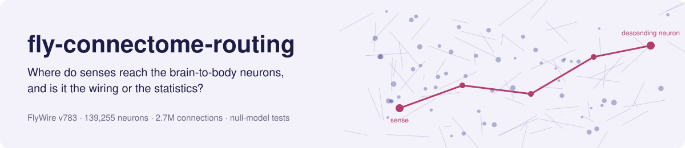
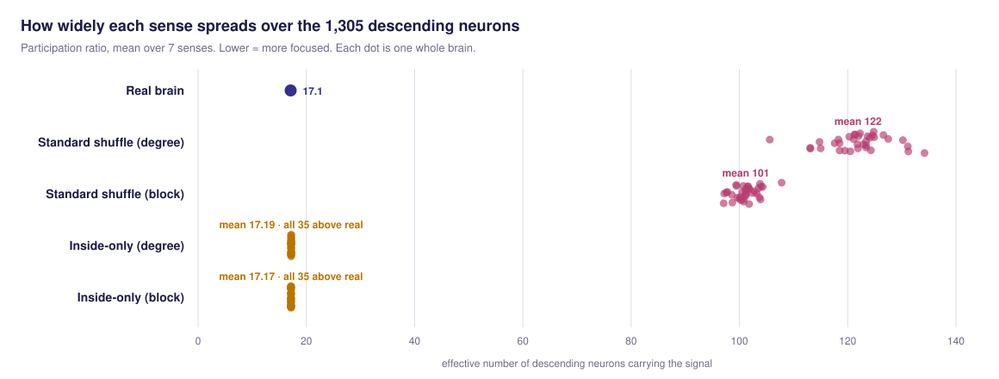
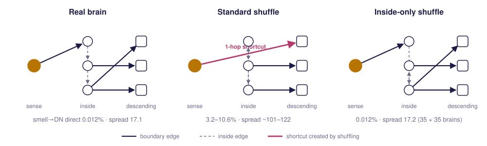

<picture>
  <source media="(prefers-color-scheme: dark)" srcset="assets/banner-dark.svg">
  
</picture>

<p align="center">
  
  
  
  <a href="LICENSE"></a>
</p>

<p align="center"><b>Bhagyashree Besra</b> · since September 2026</p>

---

## Summary

The complete wiring diagram of the adult fruit fly brain is now used as a ready-made network for simulations, embodied models and AI demos. A claim that *the real wiring* does something needs a fair baseline: randomised brains with the same number of connections per neuron.

This project asks a sharper version of that question for one function, **getting each sense to the right brain-to-body (descending) neurons**. We drive 7 sensory classes through a rate model of all 139,255 neurons and measure how widely each signal spreads over the 1,305 descending neurons, in the real brain and in matched randomised brains.

> **Concluded 31 Oct 2026; preprint to come.** Read the [study conclusions](results/CONCLUSIONS.md) first. **The rate-model results below are superseded:** the real brain's 0.5% advantage is a [scaling artefact](results/exp08c_notes.md). The sections below are kept as the record of what was run.

> **Correction, 30 Oct 2026.** An audit found that the rate model's gain calibration never took effect: gain was 0.001, the search floor, in all 638 runs, so signals barely travelled past one step. The rate-model findings on this page may be largely built into that setting. Read the [study conclusions](results/CONCLUSIONS.md) and [what changed](results/CORRECTIONS.md) first. A [gain sweep, step 8a](results/exp08_notes.md) gave no answer, and the [test at gain 1.0](results/exp08b_notes.md) compared brains at different operating points, so the question stays open.

> **Preliminary.** The decisive control (inside-only randomisation, 35 + 35 brains) finished on 27 Oct 2026 and changes how the earlier result reads (see below). Nothing here is peer-reviewed. The spiking-model test (step 6, 30 Oct 2026) did not replicate the rate-model focus result, so the rate-model conclusions below should not be generalised.

## Key result so far

<picture>
  <source media="(prefers-color-scheme: dark)" srcset="assets/results-dark.svg">
  
</picture>

Standard randomisation spreads each sense **6–7× wider** than the real brain, while the driven input is the same in every brain (dimensionality ≈ 2,428 and 1.74% active describe the driven neurons, not the network's state; see the correction above). But standard randomisation also moves the connections at the brain's edges, and that creates shortcuts:

<picture>
  <source media="(prefers-color-scheme: dark)" srcset="assets/shuffles-dark.svg">
  
</picture>

When the 158,808 boundary connections are locked and only the 2.54M inside connections are randomised, **the focus almost entirely survives**: 17.19 (degree-preserving) and 17.17 (block-preserving) vs 17.10 in the real brain. The real brain is still more focused than all 70 inside-only brains (p = 1/36 for each type; separation z = 8.0 and 11.2), and than all 400 at 200 per type (step 5: p = 0.005 for each type), but the difference is about 0.5%, against a 6–7× gap under standard randomisation.

**Superseded:** the small advantage reported here came from spectral-radius scaling, not from wiring (step 8c). The result is consistent with [Park 2026](https://arxiv.org/abs/2609.39248) at single-neuron scale and across 7 senses. The large z-scores reflect how little the inside-only brains vary, not a large effect.

### Which neurons, not how many (step 4a)

Inside-only shuffling leaves the *spread* unchanged, but it moves *where* each sense lands. The simulated descending-neuron activity was compared with the published structural map of Stürner et al. 2025 (Spearman ρ, per sense; 35 + 35 randomised brains):

| Sense | Real | Inside-only | Standard | Direct to DNs |
|---|---|---|---|---|
| Touch (mechanosensory) | 0.72 | 0.72 | −0.09 | 27.6% |
| Visual projection neurons | 0.64 | 0.63 | 0.17 | 4.2% |
| Taste | 0.80 | 0.66 | −0.03 | 2.8% |
| Humidity | 0.43 | 0.24 | 0.08 | 1.1% |
| Photoreceptors | 0.67 | 0.43 | 0.12 | 0.19% |
| Smell | 0.63 | 0.38 | 0.17 | 0.012% |
| **Mean** | **0.65** | **0.51 ± 0.01** | **0.07 ± 0.01** | |

- The simulation **reproduces the structural map** in the real brain, so two independent methods, dynamic and static, agree.
- **Standard randomisation erases the match**; **inside-only randomisation weakens it** (step 4b shows why: the map itself changes). No randomised brain of either kind matches the real one, for any sense (p = 1/36 each).
- Senses with direct routes keep their match; senses that travel through several inside layers lose 18–40% of it. Across the 6 senses the loss is perfectly ordered by direct share (Spearman ρ = −1.0; exploratory, n = 6).

So **the boundary sets how many descending neurons a sense reaches; for multi-layer senses, the interior wiring sets which ones.** Details: [results/exp04_notes.md](results/exp04_notes.md).

### The map itself moves (step 4b)

Stürner's map was recomputed on every randomised brain with the published flow model (Schlegel et al. 2021, as used by Dorkenwald et al. 2024). Our rebuild reproduces Stürner's ranks on the real brain at ρ 0.91–0.97 for all 8 senses (bar of 0.90 set beforehand).

| | Map vs real map | Simulation vs own map |
|---|---|---|
| Real brain | — | **0.72** |
| Inside-only (35) | 0.57 ± 0.02 | 0.62 ± 0.01 |
| Standard (35) | 0.09 ± 0.01 | 0.57 ± 0.02 |

- **Standard shuffles replace the map**, yet the simulation still follows each brain's new map. Step 4a's drop to 0.07 was a changed map, not a broken simulation.
- **Inside-only shuffles keep about half the map:** touch 0.91 and visual projection neurons 0.84 survive almost whole; multi-layer senses keep 0.38–0.60 (follows direct share, ρ = 0.94; exploratory, n = 6).
- **Simulation and map agree best in the real wiring:** 0.72 vs at most 0.64 in all 70 randomised brains (p = 1/36 for both types).

The step 4a conclusion now holds under two independent methods. Details: [results/exp04b_notes.md](results/exp04b_notes.md).

## Results at a glance

| | Result | Detail |
|---|---|---|
| **Routing vs randomised brains** | Real 17.1 · degree-shuffled 122 · block-shuffled 101 (35 each, p = 1/36) | [results/exp01_notes.md](results/exp01_notes.md) |
| **Inside-only randomisation** | Real 17.10 · inside-only 17.19 (degree) / 17.17 (block); real beats all 70 (p = 1/36 each) but by ~0.5%; boundary and invariants checked in every brain | [C1](results/exp01_routing_vs_gross_C1.csv) · [C2](results/exp01_routing_vs_gross_C2.csv) |
| **Scaled to 200 per type** (step 5) | Real beats all 200 brains of every type, p = 0.005: spread 17.10 vs 17.19 / 17.17 (inside-only) and 122 (standard); map agreement ρ 0.65 vs 0.51 / 0.52 / 0.07 | [results/exp05_notes.md](results/exp05_notes.md) |
| **Cross-behaviour leakage** (step 7) | Channel separation: real 0.985 · inside-only 0.983 / 0.984 · standard 0.815 (200 each, p = 0.005; pre-registered rule met). Taste activity on non-taste DN clusters: 25% real vs 98% standard | [results/exp07_notes.md](results/exp07_notes.md) |
| **Simulation vs Stürner's map** (step 4a) | Spearman ρ, simulated DN activity vs Stürner's rank for that sense: real 0.65 · inside-only 0.51 ± 0.01 · standard 0.07 ± 0.01 (35 each, p = 1/36) | [results/exp04_notes.md](results/exp04_notes.md) |
| **Stürner's map on randomised brains** (step 4b) | Flow model reproduces Stürner's ranks (ρ 0.91–0.97, 8/8 senses). Map vs real map: inside-only 0.57 · standard 0.09. Simulation vs own map: real 0.72 · inside-only 0.62 · standard 0.57 (35 each, p = 1/36) | [results/exp04b_notes.md](results/exp04b_notes.md) |
| **Shortcut statistics** | Smell → descending direct share 0.012% real vs 3.2% after shuffling; touch is the exception (27.6% direct in the real brain) | [results/exp01_smoke_paths_C.csv](results/exp01_smoke_paths_C.csv) |
| **Shiu et al. 2024 spiking model** | Reproduced: r = 0.99 over 386 neurons against published rates | [REPRODUCTIONS.md](REPRODUCTIONS.md) |
| **Spiking-model test** (step 6) | Sugar → descending spread, 15.1M connections: real 34.0 · inside-only 20.7 / 21.7 (50 each) · standard 1.7 (19). Pre-registered rule **not met** (p = 1.0): the rate-model focus result does not replicate here. Exploratory: shuffled brains fire about half as many neurons, and MN9 (feeding) drops from 75 Hz to 0 / 29 Hz | [results/exp06_notes.md](results/exp06_notes.md) |
| **Descending-neuron identities** | 1,303 / 1,305 matched to the Stürner et al. 2025 atlas; each sense lands on neurons the atlas also assigns to it | [results/dn_labels_summary.md](results/dn_labels_summary.md) |

## Pipeline

<picture>
  <source media="(prefers-color-scheme: dark)" srcset="assets/pipeline-dark.svg">
  
</picture>

Arrows are labelled with what moves between steps. Box outlines show status.

**The gate.** Rule: yes if the real brain's spread is lower than the inside-only shuffles' at p &lt; 0.05 (empirical permutation p, see Methods) for both shuffle types. Step 1 gives p = 1/36 for both, so the answer is **yes → scale to 200**. The effect is small (~0.5%), which is why more shuffles were needed to pin it down; at 200 per type (step 5) p = 0.005 for both. The rule was written down after step 1 had run; it is the standard test already used throughout, and it gives the same answer as before.

**Correction (28 Oct 2026).** An earlier version of this figure put the comparison with Stürner's map on the gate's "no" exit, and this README said step 1's small effect meant comparing with the map *instead of* scaling up. Both were wrong: the map comparison asks a separate question (which neurons, not how many) and does not depend on the gate, and a "yes" at the gate leads to scaling up.

## Roadmap

| Step | Question | Status |
|---|---|---|
| 1 | Does the focus survive inside-only randomisation? | 🟢 done: yes, ~99.5% survives |
| 2 | Where do shortcuts appear, sense by sense? | 🟢 first table |
| 3 | Which known descending neurons does each sense reach? | 🟢 done, exploratory |
| 4 | Does the simulation agree with Stürner's structural map, and does the map survive randomisation? | 🟢 done: agrees (ρ 0.65); inside-only shuffles keep ~half the map, standard shuffles replace it (4a + 4b) |
| 5 | Scale to 200 randomised brains per type (steps 1 and 4a) | 🟢 done: real beats all 200 of every type (p = 0.005); every 35-brain result holds |
| 6 | Same test in the Shiu spiking model | 🟢 done: **no** (rule fixed before the run): the real brain's spread is 34.0 vs 20.7 / 21.7 inside-only, p = 1.0. Shuffled brains carry about half the activity, so this measure mixes focus with throughput; the sugar → feeding neuron response is lost (exploratory). See [notes](results/exp06_notes.md) |
| 6b | Does matching activity reveal focus? | 🟢 done, exploratory: rule not met (real at 50 Hz: 260 firing, spread 21.2; target 177 not reached). See [notes](results/exp06b_notes.md) |
| 6c | Is the real brain more focused at equal activity? | 🟢 done, new experiment: **no answer**. None of 7 input rates landed on the target: activity jumps from 139 to 197 near 40 Hz. See [notes](results/exp06c_notes.md) |
| 7 | Do shortcuts make behaviours leak into each other? | 🟢 done: inside-only shuffles mix senses slightly more (separation 0.985 → 0.983, p = 0.005, rule met); standard shuffles much more (→ 0.815) |
| Audit | Do the numbers and claims hold? | 🟢 done: numbers recompute, but gain was never calibrated. See [corrections](results/CORRECTIONS.md) |
| 8a | Real brain at 6 gains: where do signals spread? | 🟢 done: **no answer**, no gain met the bar (direct-target share 99.6% → 61%). See [notes](results/exp08_notes.md) |
| 8b | Inside-only shuffles at gain 1.0 | 🟢 done, new experiment: rule met (30.2 vs 289 / 233, p = 0.02), but **not comparable**: shuffled brains saturate because the real brain's spectral radius is about 5–7× larger. See [notes](results/exp08b_notes.md) |
| 8c | Does the advantage survive at the shuffles' effective gain? | 🟢 done: **no**, artefact: 17.191 vs 17.194 (p = 0.27), 17.163 vs 17.165 (p = 0.34). See [notes](results/exp08c_notes.md) |

Reasoning for each step and the literature gaps it fills: [LITERATURE_GAPS.md](LITERATURE_GAPS.md).

## Methods in brief

- **Connectome:** FlyWire v783, connections with ≥ 5 synapses, each signed by the presynaptic neuron's predicted neurotransmitter (Eckstein et al. 2024).
- **Dynamics:** frozen leaky-tanh rate operator with no fitted single-neuron parameters. A gain search was meant to set every brain to the same operating point, but it returned its floor (0.001) in all 638 runs.
- **Randomised brains:** directed Maslov–Sneppen edge swaps keeping in- and out-degree, weights and Dale's law. Variants: block-preserving (swaps within cell classes) and inside-only (sensory-out and descending-in edges locked, as in Park 2026). Every surrogate is checked against its invariants and the run aborts on any violation.
- **Measures:** participation ratio over descending neurons (spread), channel separation, dimensionality, active fraction, direct-share and hop statistics.
- **Statistics:** empirical p = (1 + surrogates at least as extreme) / (N + 1); z-scores against the surrogate distribution.

## Closest prior work

| Paper | Relation |
|---|---|
| Therianos 2026, [arXiv:2606.17745](https://arxiv.org/abs/2606.17745) | Larval connectome: exact wiring governs input routing. This project is the adult, signed, descending-neuron test |
| Park 2026, [arXiv:2609.39248](https://arxiv.org/abs/2609.39248) | Null-model choice at the sensory-motor boundary decides connectome comparisons |
| Dhiman 2026, [arXiv:2604.04033](https://arxiv.org/abs/2604.04033) | flyvis advantages vanish under degree-preserving nulls |
| Shiu et al. 2024, *Nature* | Whole-brain spiking model, reproduced here |
| Stürner et al. 2025, *Nature* | Descending-neuron atlas used for identities |
| Lin et al. 2024, *Nature* | Network statistics of the same connectome against null models |

Full reading list: [PAPERS.md](PAPERS.md).

## Reproducing

```bash
# 1. Data: FlyWire v783 Codex tables (neurons, connections, classification,
#    consolidated_cell_types) from
#    https://storage.googleapis.com/flywire-data/codex/data/fafb/783  ->  data/flywire783/
# 2. Python 3.11; install the package (pinned numpy, scipy, pandas, pyarrow)
pip install -e .
# 3. Tests: invariants, flow model, and (slow) brain #1 reproduces steps 1 + 4a
python -m unittest discover -s tests
FLYNULL_SLOW=1 python -m unittest tests.test_regression
# 4. Inside-only randomisation, 35 replicates
python experiments/exp01_routing_vs_gross.py --generators interior_degree_preserving \
       --n-nulls 35 --swaps-per-edge 10 --tag _C1
```

Using the package in your own code:

```python
import numpy as np
from flynull import data
from flynull.routing import boundary_masks, evaluate, make_surrogate, sensory_channels

c = data.load()                                     # FlyWire v783
channels = sensory_channels(c.meta)
readout = np.flatnonzero(c.meta["super_class"].eq("descending").to_numpy())
sign = c.meta["nt_sign"].to_numpy()
labels = c.meta["super_class"].fillna("na").astype("category").cat.codes.to_numpy()
S = make_surrogate("interior_degree_preserving", c.W, np.random.default_rng(1000), sign,
                   labels, 10, boundary_masks(c.n, channels, readout))  # inside-only shuffle
row, profiles = evaluate(S, channels, readout, "inside-only")         # spread, separation, ...
```

```
flynull/             the package: data loading, null models, rate model, measures,
                     routing, Stürner map scoring, flow model
experiments/         one script per study step (exp01 … exp07, Shiu model runs)
tests/               invariant, flow-model and regression tests
scratch/             one-off inspection scripts
results/             result tables, summaries and figures
assets/              README figures
REPRODUCTIONS.md     what has been checked against published numbers
LITERATURE_GAPS.md   prior work and what this study adds
```

FlyWire data, paper PDFs and third-party code are not redistributed here.

## Citing

See [CITATION.cff](CITATION.cff). Please also cite FlyWire (Dorkenwald et al. 2024; Schlegel et al. 2024) and any paper whose method you use.

## Licence and data

The code is MIT-licensed ([LICENSE](LICENSE)). FlyWire data is CC BY-NC 4.0. Descending-neuron annotations are from Stürner et al. 2025.

<sub>AI coding assistants (Claude Code) helped write the analysis code and literature summaries. Study design decisions, checks against published numbers and interpretation are the author's responsibility.</sub>
