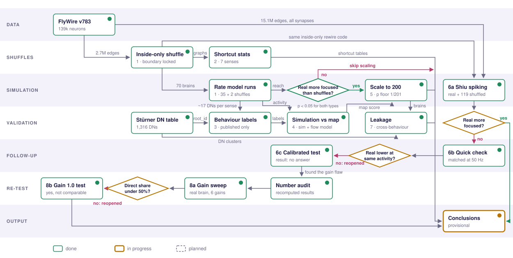

<picture>
  <source media="(prefers-color-scheme: dark)" srcset="assets/banner-dark.svg">
  
</picture>

<p align="center">
  
  
  
  <a href="LICENSE"></a>
</p>

<p align="center"><b>Bhagyashree Besra</b> · since September 2026</p>

---

## Summary

The complete wiring diagram of the adult fruit fly brain is now used as a ready-made network for simulations, embodied models and AI demos. A claim that *the real wiring* does something needs a fair baseline: randomised brains with the same number of connections per neuron.

This project asks a sharper version of that question for one function, **getting each sense to the right brain-to-body (descending) neurons**. We drive 7 sensory classes through a calibrated rate model of all 139,255 neurons and measure how widely each signal spreads over the 1,305 descending neurons, in the real brain and in matched randomised brains.

> **Preliminary.** The decisive control is still running. Its first test changes how the earlier result reads (see below). Nothing here is peer-reviewed.

## Key result so far

<picture>
  <source media="(prefers-color-scheme: dark)" srcset="assets/results-dark.svg">
  
</picture>

Standard randomisation spreads each sense **6–7× wider** than the real brain, while overall activity stays identical (dimensionality ≈ 2,428, 1.74% of neurons active in every brain). But standard randomisation also moves the connections at the brain's edges, and that creates shortcuts:

<picture>
  <source media="(prefers-color-scheme: dark)" srcset="assets/shuffles-dark.svg">
  
</picture>

When the 158,808 boundary connections are locked and only the 2.54M inside connections are randomised, the first test shows **no loss of focus** (17.2 vs 17.1). If the full run (35 + 35 replicates, in progress) confirms this, the routing is set at the brain's sensory and motor boundaries rather than by its interior wiring. That would independently support [Park 2026](https://arxiv.org/abs/2609.39248) at single-neuron scale and across 7 senses.

## Results at a glance

| | Result | Detail |
|---|---|---|
| **Routing vs randomised brains** | Real 17.1 · degree-shuffled 122 · block-shuffled 101 (35 each, p = 1/36) | [results/exp01_notes.md](results/exp01_notes.md) |
| **Shortcut statistics** | Smell → descending direct share 0.012% real vs 3.2% after shuffling; touch is the exception (27.6% direct in the real brain) | [results/exp01_smoke_paths_C.csv](results/exp01_smoke_paths_C.csv) |
| **Shiu et al. 2024 spiking model** | Reproduced: r = 0.99 over 386 neurons against published rates | [REPRODUCTIONS.md](REPRODUCTIONS.md) |
| **Descending-neuron identities** | 1,303 / 1,305 matched to the Stürner et al. 2025 atlas; each sense lands on neurons the atlas also assigns to it | [results/dn_labels_summary.md](results/dn_labels_summary.md) |

## Pipeline

<picture>
  <source media="(prefers-color-scheme: dark)" srcset="assets/pipeline-dark.svg">
  
</picture>

Arrows are labelled with what moves between steps. Box outlines show status. The gate is answered by step 1's full run.

## Roadmap

| Step | Question | Status |
|---|---|---|
| 1 | Does the focus survive inside-only randomisation? | 🟡 running |
| 2 | Where do shortcuts appear, sense by sense? | 🟢 first table |
| 3 | Which known descending neurons does each sense reach? | 🟢 done, exploratory |
| 4 | Does the simulation agree with Stürner's structural map, and does the map survive randomisation? | ⚪ next |
| 5 | Scale to 200 randomised brains per type | ⚪ if step 1 says yes |
| 6 | Same test in the Shiu spiking model | ⚪ planned |
| 7 | Do shortcuts make behaviours leak into each other? | ⚪ planned |

Reasoning for each step and the literature gaps it fills: [LITERATURE_GAPS.md](LITERATURE_GAPS.md).

## Methods in brief

- **Connectome:** FlyWire v783, connections with ≥ 5 synapses, each signed by the presynaptic neuron's predicted neurotransmitter (Eckstein et al. 2024).
- **Dynamics:** frozen leaky-tanh rate operator with no fitted single-neuron parameters. Gain is calibrated so every brain runs at the same operating point.
- **Randomised brains:** directed Maslov–Sneppen edge swaps keeping in- and out-degree, weights and Dale's law. Variants: block-preserving (swaps within cell classes) and inside-only (sensory-out and descending-in edges locked, as in Park 2026). Every surrogate is checked against its invariants and the run aborts on any violation.
- **Measures:** participation ratio over descending neurons (spread), channel separation, dimensionality, active fraction, direct-share and hop statistics.
- **Statistics:** empirical p = (1 + surrogates at least as extreme) / (N + 1); z-scores against the surrogate distribution.

## Closest prior work

| Paper | Relation |
|---|---|
| Therianos 2026, [arXiv:2606.17745](https://arxiv.org/abs/2606.17745) | Larval connectome: exact wiring governs input routing. This project is the adult, signed, descending-neuron test |
| Park 2026, [arXiv:2609.39248](https://arxiv.org/abs/2609.39248) | Null-model choice at the sensory-motor boundary decides connectome comparisons |
| Dhiman 2026, [arXiv:2604.04033](https://arxiv.org/abs/2604.04033) | flyvis advantages vanish under degree-preserving nulls |
| Shiu et al. 2024, *Nature* | Whole-brain spiking model, reproduced here |
| Stürner et al. 2025, *Nature* | Descending-neuron atlas used for identities |
| Lin et al. 2024, *Nature* | Network statistics of the same connectome against null models |

Full reading list: [PAPERS.md](PAPERS.md).

## Reproducing

```bash
# 1. Data: FlyWire v783 Codex tables (neurons, connections, classification,
#    consolidated_cell_types) from
#    https://storage.googleapis.com/flywire-data/codex/data/fafb/783  ->  data/flywire783/
# 2. Python 3.11 with numpy, scipy, pandas
# 3. Inside-only randomisation, 35 replicates
python flynull/exp01_routing_vs_gross.py --generators interior_degree_preserving \
       --n-nulls 35 --swaps-per-edge 10 --tag _C1
```

```
flynull/             data loading, null models, rate model, measures, experiments
results/             result tables, summaries and figures
assets/              README figures
REPRODUCTIONS.md     what has been checked against published numbers
LITERATURE_GAPS.md   prior work and what this study adds
```

FlyWire data, paper PDFs and third-party code are not redistributed here.

## Citing

See [CITATION.cff](CITATION.cff). Please also cite FlyWire (Dorkenwald et al. 2024; Schlegel et al. 2024) and any paper whose method you use.

## Licence and data

The code is MIT-licensed ([LICENSE](LICENSE)). FlyWire data is CC BY-NC 4.0. Descending-neuron annotations are from Stürner et al. 2025.

<sub>AI coding assistants (Claude Code) helped write the analysis code and literature summaries. Study design decisions, checks against published numbers and interpretation are the author's responsibility.</sub>
